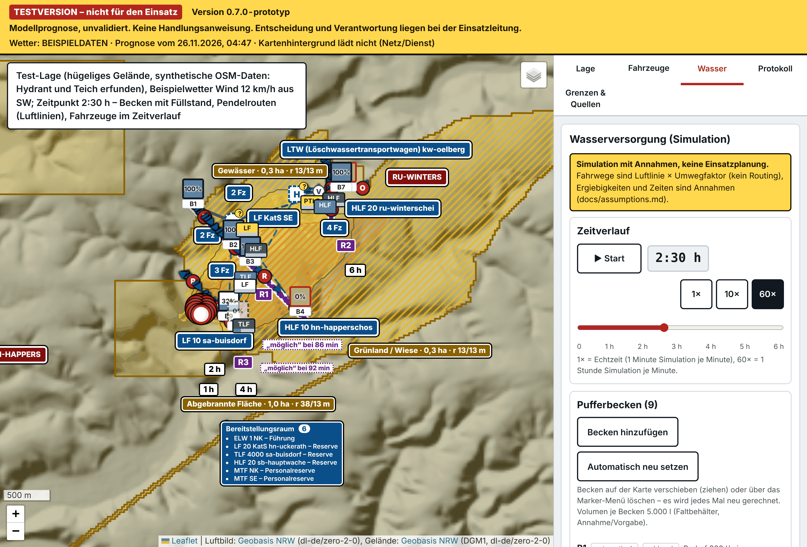

# Waldbrand-Lagebild Neunkirchen-Seelscheid (Prototyp, Version 0.7.0-prototyp)

> **TESTVERSION – nicht für den Einsatz.** **Modellprognose, unvalidiert. Keine Handlungsanweisung. Entscheidung und Verantwortung liegen bei der Einsatzleitung.**

Veröffentlicht (Test) unter <https://sfelske3006-stack.github.io/waldbrand-app/> (GitHub Pages, Unterpfad `/waldbrand-app/`; alle Pfade relativ).

Browser-App für Einsatzleiter bei Vegetations- und Waldbränden: Brandfläche einzeichnen, Wetter laden oder vor Ort eingeben, Ausbreitung für 1/2/4/6 h mit Unsicherheitsband berechnen, einfache Vorschläge für Riegelstellungen und Fahrzeugstandorte, dazu eine Simulation der Löschwasserversorgung (Pufferbecken, Förderstrecke, Pendelverkehr) und Vorschläge für Rückzugsflächen mit Fluchtwegen je Fahrzeug. Die gesamte Rechnung läuft im Browser, ein Server ist nicht nötig.

## Start

```bash
cd waldbrand-app
python3 -m http.server 8080      # oder: npm start
```

Dann im Browser `http://localhost:8080` öffnen. Ein statischer Server ist nötig, weil die Fahrzeugliste per `fetch` geladen wird (über `file://` geht das nicht; dann die Liste in der Ansicht „Fahrzeuge“ importieren).

Tests:

```bash
npm test          # Unit- und Szenariotests: Berechnungskern (model.test.mjs), Ortssuche (search.test.mjs), Wasserversorgung (water.test.mjs), node --test
npm run e2e       # Browser-Test mit Playwright/Chromium, Screenshots nach docs/ (u. a. screenshot-konturen.png, screenshot-raster.png, screenshot-fahrzeuge.png, screenshot-suche.png, screenshot-wasser.png)
npm run build:vorschau   # Einzeldatei-Vorschau dist/vorschau.html (für die Artifact-Seite)
```

Stand 0.6.0: 101 Unit-/Szenariotests (78 Modell/Suche + 23 Wasserversorgung) und 108 Browser-Tests, alle bestanden.

`npm run e2e` prüft zusätzlich den Betrieb unter einem Unterpfad (statischer Server unter `/waldbrand-app/` wie GitHub Pages), das Cache-Busting (`?v=<Version>` an allen eigenen Skripten, CSS- und Datendateien) und erzeugt `docs/screenshot-gelaendewind.png`.

**Version und Cache-Busting:** Die Version steht an drei Stellen und wird per Test auf Gleichheit geprüft: `js/params.js` (`PARAMS.version`), `index.html` (`window.WB_VERSION` im kleinen Loader) und `package.json`. Der Loader in `index.html` lädt alle eigenen CSS- und JS-Dateien aus einer zentralen Liste mit `?v=<Version>`; Datendateien (`data/*.json`, `data/dgm25.bin`) lädt die App ebenfalls mit `?v=`. Bei einer neuen Version alle drei Stellen ändern. Neue JS-Dateien in `WB_JS` (index.html) eintragen (Test prüft das).

Geländemodell neu erzeugen (nur nötig bei neuem DGM-Stand oder anderem Gebiet; Ergebnis liegt bereits in `data/`):

```bash
# Voraussetzungen: GDAL-Kommandozeilenwerkzeuge (z. B. apt-get install gdal-bin), Python 3 mit numpy,
# Netzzugang zu www.opengeodata.nrw.de. Rohdaten (~1,2 GB, 483 Kacheln) NICHT ins Projekt legen.
python3 tools/build-dgm.py --raw-dir /tmp/dgm_raw            # lädt, mittelt, schreibt data/dgm25.bin + .json
python3 tools/build-dgm.py --raw-dir /tmp/dgm_raw --stream   # bei wenig Plattenplatz: Kachel für Kachel, Rohdaten sofort löschen
python3 tools/build-dgm.py --raw-dir /tmp/dgm_raw --keep-raw # 1-m-Kacheln als Cache behalten
```

Weitere Werkzeuge (Rohdaten nicht ins Projekt legen): `tools/build-gemeindeteile.py --gpkg <ALKIS-GeoPackage Rhein-Sieg-Kreis>` erzeugt `data/gemeindeteile.json` (Gemarkungen, ca. 50 KB); `tools/merge-fahrzeuge-rsk.py <fahrzeuge_rsk.json>` führt die Kreis-Fahrzeugrecherche mit `data/fahrzeuge.json` zusammen.

Das Skript liest die Gemeindegrenze aus den amtlichen Verwaltungsgrenzen (DVG1), legt 5 km Puffer an, lädt nur die nötigen 1-km-Kacheln, mittelt mit `gdalbuildvrt` + `gdalwarp -r average` auf ca. 25 m (EPSG:4326) und prüft den Höhenbereich. Danach `npm test` ausführen (Test „Mitgeliefertes DGM“).

Google Maps (optional): In `config.js` `googleMapsApiKey` eintragen. Erst dann erscheint im Ebenen-Menü „Google Luftbild (nur Anzeige)“. Ohne Key gibt es keinen Umschalter. Google-Bilder werden nie ausgewertet; die Analyse nutzt nur offene Daten.

## Bedienung (Kurzfassung)

1. Beim Start die Modellgrenzen bestätigen (einmal je Sitzung, wird protokolliert).
   **Suchfeld oben links** in der Werkzeugleiste: Ortsteil, Straße, Adresse mit Hausnummer, Rettungspunkt-Nummer oder Koordinate eingeben (siehe Abschnitt „Suche“).
2. **Brandfläche zeichnen**: Eckpunkte antippen, „Fläche fertig“. Punkte bleiben verschiebbar. Alternativ **Zündpunkt + Radius**. „Mein Standort“ zentriert per GPS (nur nach Einwilligung, nur lokal).
3. **Wetter laden** (Open-Meteo) oder **Beispieldaten** (deutlich als fiktiv markiert). Unter „Werte vor Ort überschreiben“ alle Werte manuell setzen; überschriebene Werte sind mit * markiert.
4. Optional **OSM-Daten laden** (Brennstoff, Wege, Gewässer, Gebäude, Hydranten). Ohne OSM wird mit einem wählbaren Ersatz-Brennstoff ohne Barrieren gerechnet; das wird im Ergebnis angezeigt. Das **Geländemodell** (DGM, offline) wird beim Start automatisch geladen; Status im Abschnitt „Gelände & Brennstoff“. „Geländeschummerung anzeigen“ blendet eine offline berechnete Schummerung ein; im Ebenen-Menü gibt es zusätzlich die amtliche WMS-Schummerung (online).
5. **Prognose berechnen**: je Horizont „wahrscheinlich“ (halbtransparente Fläche, durchgezogener Rand) und „möglich“ (Schraffur, gestrichelter Rand), dünne schwarze Linie = Referenzlauf, Beschriftung „1 h … 6 h“. **Darstellung umschaltbar in der Legende**: „Konturen“ (Standard; Isochronen aus dem 25-m-Raster per Marching Squares, Chaikin-Glättung, Hinweis zur Flächenabweichung) oder „Raster 25 m“ (ungeglättete Zellen, Umrisse entlang der Zellränder, für Fachleute). Die Wahl wird auf dem Gerät gespeichert. Kennzahlen beruhen immer auf dem Raster.
6. **Einsatzvorschläge**: Riegellinien (R1…R3) nur, wenn sie zum Zeitpunkt der frühesten Einsatzbereitschaft eines Löschfahrzeugs (siehe „Bereitschaft“ unten) zuzüglich 30 min Mindest-Wirkzeit (Annahme) vollständig außerhalb der „möglich“-Zone liegen, quer zur Hauptausbreitungsrichtung und vor der Front; diese Grenze ist als lila gepunktete Linie eingezeichnet. Sonst Meldung „Keine geeignete Riegelstellung gefunden“ mit Grund. Löschfahrzeuge mit Wasser werden nach Linienlänge (300 m je Fahrzeug, Annahme), Objektschutz an bedrohter Bebauung und Wasserversorgung/Pendelverkehr verteilt. **Ab 0.4.2** werden übrige wasserführende Fahrzeuge nicht mehr pauschal geparkt: Sind Fahrzeuge für die vorderste Linie zu spät einsatzbereit, wird für die zweite Bereitschaftsstufe (z. B. 40 statt 25 min) eine **Auffanglinie** gesucht; danach **verstärken** rechtzeitig bereite Fahrzeuge eine Linie bis max. 4 Fahrzeuge und bis zu zwei Fahrzeuge übernehmen die **Flankensicherung** (Annahme, siehe docs/assumptions.md). Erst dann stehen Fahrzeuge im **Bereitstellungsraum** (ein Marker mit Liste) – jedes mit konkreter Begründung, warum es dort steht. Fahrzeuge ohne Löschwasser (ELW, MTF, DLK, GW-G) nie im Löscheinsatz. Fahrzeuge auf der Karte verschieben (wird geprüft und markiert), Vorschläge sperren oder verwerfen, „Vorschläge neu berechnen“ zeigt den Unterschied.
   **Bereitschaft je Fahrzeug (ab 0.4.0)**: Fahrzeuge der FF Neunkirchen-Seelscheid nach **Vorgabe Auftraggeber (22.11.2026)**: Einsatzort im eigenen Gemeindeteil 25 min, im anderen 40 min von Alarm bis löschbereit (inkl. Ausrücken, Anfahrt, Aufbau). Gemeindeteil automatisch aus der ALKIS-Gemarkung (teils Annahme, siehe unten) oder manuell („Einsatzort im Gemeindeteil“). Fahrzeuge anderer Kommunen: Anfahrt **geschätzt** = Luftlinie Wache→Einsatzstelle × 1,4 ÷ 50 km/h (je Klasse) + 7 min Ausrücken, plus 45 min Aufbau (Annahmen, **kein Routing**). Fahrzeuge werden nach Bereitschaft eingeplant; wer für einen Riegelabschnitt zu spät käme, wird als „zu spät für Riegel X“ gekennzeichnet. Ohne Wachenkoordinate: nicht eingeplant (Hinweis). Option „nur Fahrzeuge bis X min Anfahrt einplanen“ (Standard 45 min).
   **Pflichtfahrzeuge** (Vorgabe Auftraggeber): HLF 20, LF 20 und LF KatS des LZ Seelscheid werden bei jedem Einsatz vorrangig eingebunden (unabhängig von der Anfahrtsgrenze, Sicherheitsregeln gelten weiter); ohne sichere Aufgabe „Pflichtfahrzeug – bereitgestellt“ im Bereitstellungsraum mit Begründung. Häkchen „Pflicht“ je Fahrzeug in der Fahrzeugliste.
   **Grundschutz** (Vorgabe Auftraggeber): je ein wasserführendes Fahrzeug aus einer Nachbarkommune an den Gerätehäusern Neunkirchen und Seelscheid (bevorzugt HLF/LF, dann TLF/MLF/TSF-W, kürzeste geschätzte Anfahrt zum Gerätehaus; Annahme), manuell tauschbar, auf der Karte („GS“), in Liste, Protokoll und Export. **Ab 0.4.2** wird der Grundschutz direkt nach den Einsatzaufgaben und VOR Verstärkung, Flanke und Bereitstellungsraum vergeben; ein Grundschutzfahrzeug steht am Gerätehaus und nie im Bereitstellungsraum.
   **Geländewind** (Abschnitt 3, Schalter „Geländewind: an/aus“): lokaler Wind und Feuchte je Zelle aus dem DGM, Ebene „Geländewind“ mit Pfeilen (alle 250 m, Farbe = Faktor lokal/synoptisch). Aus = Rechnung wie 0.3.0 (bitgenau, Test).
7. **Rückzugsflächen und Fluchtwege (Abschnitt 6 im Reiter „Lage“, neu in 0.7.0)**: Nach jeder Prognose werden aus Landnutzung (OSM) und Gelände Flächen ohne Brandlast vorgeschlagen (Gewässer, abgebrannte Fläche, Steinbruch, Parkplatz, Sportfläche, Hoffläche, Acker, Grünland), je Fläche mit Soll-Radius, Status (geeignet / bedingt geeignet / ungeeignet) und Begründung, dazu je eingesetztem Fahrzeug ein Fluchtweg (Fahrzeug und zu Fuß) mit geschätzter Zeit. Ist die Fluchtzeit plus Sicherheitspuffer größer als die Zeit, bis die „möglich“-Front den Standort erreichen kann, erscheint eine Warnung an der Fahrzeugkarte, auf der Karte und im Protokoll. Jede Fläche lässt sich verwerfen (bleibt über Neuberechnungen erhalten, wird protokolliert). **Ohne OSM-Daten wird nichts erfunden**: dann bleibt nur die abgebrannte Fläche und ein Hinweis. Details und Quellenlage: Abschnitt „Rückzugsflächen und Fluchtwege“.
8. **Wasserversorgung (Reiter „Wasser“, neu in 0.6.0)**: Aus den Fahrzeugvorschlägen (Riegel, Auffanglinie, Flanke, Objektschutz), den Entnahmestellen, dem Wegenetz und dem Gelände wird eine **Simulation** der Löschwasserversorgung über 6 h gerechnet: Pufferbecken (Faltbehälter 5.000 l), Förderstrecken bis 600 m Schlauchweg, sonst Pendelverkehr. Zeitregler mit Abspielen (1× / 10× / 60×) bewegt Fahrzeuge und Füllstände, je Becken ein Diagramm (Füllstand, Zufluss, Verbrauch). Becken lassen sich auf der Karte verschieben, hinzufügen und löschen – es wird jedes Mal neu gerechnet. Details: Abschnitt „Wasserversorgung“.
9. **Szenario B** (z. B. „Wind aus 270°“) neben A vergleichen.
10. **Protokoll**: lokale Hash-Kette (SHA-256), Export als JSON und GeoJSON, Drucken/PDF über den Browser.

## Änderungen in Version 0.7.0

**Rückzugsflächen und Fluchtwege** (neu, Abschnitt 6 im Reiter „Lage“, siehe Abschnitt „Rückzugsflächen und Fluchtwege“):
Kandidatenflächen ohne Brandlast aus OSM und aus der gezeichneten Brandfläche, Soll-Radius aus der Flammenlänge
(Byram 1959) nach Butler & Cohen (1998) mit Hang-/Windzuschlag Δ (Annahme, interpoliert), größter einbeschriebener
Kreis als Maß für „groß genug“, Status mit Begründung, zwei Kartenebenen („Safe Areas“, „Fluchtwege“) mit
Sicherheitskreis, Legende und Richtungspfeilen, Tabelle in der Seitenleiste, Fluchtwege je Fahrzeugstandort über das
25-m-Raster (Fahrzeug nur auf befahrbaren Zellen, zu Fuß nach Tobler 1993), Warnung mit Rechenweg bei zu knapper
Reserve, Verwerfen einzelner Flächen, Protokolleinträge `safearea` und `safearea_verworfen`, GeoJSON um
`rueckzugsflaeche` und `fluchtweg` erweitert.
Neu: `js/safearea.js`, `js/safearea-ui.js`, `css/safearea.css`, `tests/safearea.test.mjs`, `tests/safearea-scenario.cjs`.
**Es gibt keine belegte deutsche Vorgabe mit Zahlen** zur Größe eines Sicherheitsbereichs; die Dimensionierung stützt
sich auf US-Literatur und ist in Teilen Annahme (`PARAMS.safearea`, [docs/assumptions.md](docs/assumptions.md)).

## Änderungen in Version 0.6.0

**Wasserversorgung** (neu, eigener Reiter „Wasser“, siehe Abschnitt „Wasserversorgung“): Planung und zeitdiskrete Simulation
(1-min-Schritte, 6 h) der Löschwasserversorgung für die vorgeschlagenen Riegel-, Flanken- und Objektschutzfahrzeuge:
Pufferbecken (Faltbehälter), Förderstrecke mit Druckverlust und Höhenprofil aus dem DGM oder Pendelverkehr mit Warteschlangen
an Entnahmestelle und Becken, Engpassdiagnose im Klartext, Kennzahlen (Bedarf, Lieferung, Defizit, erstes Leerlaufen),
Kartenebenen (Becken mit Füllstand, Schlauchleitungen, Pendelrouten, Fahrzeuge im Zeitverlauf), Zeitregler mit Animation.
Protokolleinträge `wasser_annahmen`, `wasser_plan`, `wasser_becken`, `wasser_export`; GeoJSON um `pufferbecken`,
`schlauchleitung`, `pendelroute`, `wasserabnehmer` und die Einstufung der Entnahmestellen erweitert.
Neu: `js/water.js`, `js/water-params.js`, `js/water-ui.js`, `css/water.css`, `tests/water.test.mjs`.
**Alle Zahlen des Moduls sind Annahmen** (`PARAMS.wasser`, [docs/assumptions.md](docs/assumptions.md)); es ist eine
**Simulation mit Annahmen, keine Einsatzplanung**.

## Änderungen in Version 0.5.0

**Ortssuche** (neu, siehe Abschnitt „Suche“): Suchfeld in der Werkzeugleiste für Ortsteile, Straßen, Adressen mit Hausnummer,
KWF-Rettungspunkte und Koordinaten (Grad, Grad/Minuten, Grad/Minuten/Sekunden, UTM 32 ETRS89), offline aus amtlichen Daten.
Treffer zentrieren die Karte (Adresse/Rettungspunkt/Koordinate: Marker; Straße/Ortsteil/Kommune: umschließendes Rechteck),
Knopf „Als Zündpunkt setzen“ legt die Brandfläche mit dem gewählten Startradius an. Rettungspunkte zusätzlich als abschaltbare
Kartenebene mit Nummer, Tooltip und eigenem Symbol. Der Suchindex (ca. 860 KB) wird erst beim ersten Antippen des Suchfeldes
geladen, damit der Start schnell bleibt. Online-Suche (OpenStreetMap/Nominatim) nur als ausdrücklich angestoßene Ergänzung und
abschaltbar. Neu: `js/search.js`, `js/search-ui.js`, `css/search.css`, `data/suche-index.json`, `data/rettungspunkte-kwf.json`,
`tools/build-suche.py`, `tools/build-rettungspunkte.py`, `tools/httpzip.py`, `tests/search.test.mjs`.

## Suche

### Bedienung

| Eingabe | Beispiel | Ergebnis |
|---|---|---|
| Ortsteil / Ortslage | `Hermerath`, `Seelsch` | Ortsteil, Karte auf die Ortslage (Rechteck) |
| Kommune | `Much`, `Hennef` | Gemeindegebiet (Rechteck) |
| Straße | `Zum Wirbel`, `Hauptstr` | Straße mit Anzahl Hausnummern, Rechteck über alle Adressen |
| Adresse | `Zum Wirbel 12a`, `Hauptstraße 5 Much`, `Zum Wirbel 4, Neunkirchen-Seelscheid` | Adresse mit Marker |
| Rettungspunkt | `01-501-SU`, `01501su`, `rp 01-501-su` | Rettungspunkt mit Beschreibung, Schild, Urheber |
| Koordinate | `50.8045, 7.3405`, `N 50° 48.27' E 7° 20.43'`, `32U 381234 5634567` | Punkt mit Marker, Anzeige in Grad und UTM 32N |

- **Tastatur**: Pfeiltasten wählen, Enter zeigt an, Esc schließt die Liste (zweites Esc leert das Feld). Die Liste ist eine
  ARIA-Combobox mit Listbox; die aktive Zeile steht in `aria-activedescendant`. Touch-Ziele mindestens 52 px (Tablet).
- **Ergebniskarte** unter dem Suchfeld: Bezeichnung, Typ, Koordinate in Grad und UTM 32N, Quelle und Lizenz, Knopf
  **„Als Zündpunkt setzen“** (bei Flächen der Mittelpunkt) und „Schließen“. Jede Auswahl wird im Protokoll vermerkt.
- **Warnungen**: Koordinaten außerhalb des Suchgebiets oder außerhalb des Geländemodells werden gekennzeichnet; bei einer
  Hausnummer ohne Treffer erscheint die Straße mit Hinweis; Gauß-Krüger-Koordinaten werden ausdrücklich abgelehnt.
- **Rettungspunkt-Ebene** (Ebenen-Menü rechts oben, „Rettungspunkte (KWF, ab Zoom 13)“): grünes Quadrat mit weißem Kreuz,
  Nummer als Beschriftung ab Zoom 14, Popup mit Beschreibung, Schild, Urheber, Bundesland, Koordinate und Quellenvermerk.
  Nummern, die andere Kartenbeschriftungen überdecken würden, werden ausgeblendet (Marker bleibt antippbar).
- **Online-Suche**: Nur wenn offline kein Treffer gefunden wurde, erscheint eine eigene Zeile „Online suchen“. Erst beim
  Antippen geht eine Anfrage an Nominatim (kein Autocomplete, höchstens 1 Anfrage/s, auf das Gebiet begrenzt, Ergebnis mit
  „© OpenStreetMap“ gekennzeichnet). Abschaltbar im Reiter „Grenzen & Quellen“ (Häkchen) oder dauerhaft über
  `searchOnline: false` in `config.js`.

### Datenquellen und Lizenzen

| Inhalt | Quelle | Lizenz | Umfang |
|---|---|---|---|
| Straßen, Adressen mit Hausnummer | Gebäudereferenzen NRW (`gebref`, Stand 01.10.2026), Geobasis NRW | dl-de/zero-2-0 | 3.223 Straßen, 62.152 Adressen |
| Ortsteile | Basis-DLM NRW, Objektart `AX_Ortslage` (Ebene `sie01_f`, Attribut `NAM`), Geobasis NRW | dl-de/zero-2-0 (allgemeine Nutzungsbedingungen; Einzelbeleg zu prüfen) | 306 Ortslagen |
| Kommunen, Suchgebiet | DVG1 Gemeindegrenzen (Stand 12.11.2025), Geobasis NRW | dl-de/zero-2-0 | 7 Kommunen (NKS + 6 Nachbarn) |
| Rettungspunkte | KWF-Rettungspunkte, Gesamtdatensatz (Shapefile `KWF_RP.shp`), Kuratorium für Waldarbeit und Forsttechnik e. V. | **CC BY-ND 4.0** | 655 von 71.621 Punkten (Gebietsausschnitt) |
| Online-Ergänzung | OpenStreetMap / Nominatim | ODbL | nur auf Knopfdruck |

**Pflicht-Quellenvermerk Rettungspunkte** (in der App im Reiter „Grenzen & Quellen“, in der Kartenattribution, in der
Ergebniskarte und im Popup):
`© KWF-Rettungspunkte v2.21, Datenurheber, www.rettungspunkte-forst.de` – „Datenurheber“ verweist auf
<https://docs.rettungspunkte-forst.de/Metadaten_KWF_Rettungspunkte.pdf>, „www.rettungspunkte-forst.de“ auf
<https://rettungspunkte-forst.de>. Lizenz **CC BY-ND 4.0**, **Daten unverändert** (alle Attribute, Bezeichnungen und
Koordinaten wie geliefert; Bearbeitung nur räumlicher Ausschnitt und Formatwandlung Shapefile → JSON), **Version 2.21,
Stand 10/2026** (veröffentlicht 07.10.2026). Angaben ohne Gewähr
(<https://kwf2020.kwf-online.de/rettungspunkte-download/>). Das KWF exportiert etwa zweimal jährlich und verlangt, veraltete
Versionen zu löschen und durch die aktuelle zu ersetzen: Die App **warnt sichtbar**, sobald die Veröffentlichung mehr als
7 Monate zurückliegt (Reiter „Grenzen & Quellen“, Statuszeile der Suche und Kopfzeile). Dann `data/rettungspunkte-kwf.json`
mit `tools/build-rettungspunkte.py` neu erzeugen.

### Indizes neu erzeugen

Rohdaten **nicht** ins Projektverzeichnis legen und nach dem Lauf löschen (die Rohpakete sind mehrere GB groß).

```bash
# 1) Suchindex (Adressen, Straßen, Ortsteile, Kommunen). Voraussetzung: Python 3 mit pyproj und pyshp.
#    gebref:   https://www.opengeodata.nrw.de/produkte/geobasis/lk/akt/gebref_txt/gebref_EPSG25832_ASCII.zip
#    dvg1:     https://www.opengeodata.nrw.de/produkte/geobasis/vkg/dvg/dvg1/dvg1_EPSG25832_Shape.zip
#    Basis-DLM (sie01_f, nur das nötige Mitglied per HTTP-Range, siehe tools/httpzip.py):
#              https://www.opengeodata.nrw.de/produkte/geobasis/lm/akt/basis-dlm/basis-dlm_EPSG25832_Shape.zip
python3 -I tools/build-suche.py --gebref raw/gebref/gebref.txt --dvg raw/dvg/dvg1gem_nw.shp \
    --ortslage raw/ortslage_bbox.geojson --out data --fixtures tests/fixtures

# 2) Rettungspunkte (eigener Zyklus, andere Lizenz). Paket von https://rettungspunkte-forst.de herunterladen.
python3 -I tools/build-rettungspunkte.py --shp raw/kwf/KWF_RP.shp --doku raw/kwf/KWF_RP_V2_21_Doku.txt \
    --zip raw/kwf/KWF_RP.zip --veroeffentlicht 2026-10-07 --out data --fixtures tests/fixtures

npm test   # prüft Anzahlen, Stichproben gegen die Rohdaten, Quellenvermerk und Datenstand
```

Beide Skripte schreiben Metadaten (Quelle, Stand, Lizenz, SHA-256 der Rohdateien, Anzahlen) in die JSON-Dateien und legen
Stichproben als Testfixtures unter `tests/fixtures/` ab. Nach dem Austausch der KWF-Datei die Konstanten `KWF` in `js/app.js`
prüfen – der Test „Einbindung: Pflicht-Attribution …“ vergleicht sie mit der Datei.

### Bekannte Grenzen der Suche

- **Nur das Gebiet der 7 Kommunen** (Neunkirchen-Seelscheid und direkte Nachbarn). Außerhalb helfen nur Koordinaten oder die
  Online-Suche.
- **Ortsteile = benannte Ortslagen des Basis-DLM** (bebaute Flächen). Kleine Weiler, Wohnplätze, Hofnamen, Flur-, Wald- und
  Gewässernamen sowie POI (Schulen, Hallen) sind **nicht** enthalten.
- **Adressen** haben den Stand der Gebäudereferenzen (01.10.2026); neue Baugebiete können fehlen. Das Qualitätskennzeichen
  A/B/C aus `gebref` wird angezeigt, seine genaue Bedeutung ist **zu prüfen** (Formatbeschreibung nicht abrufbar).
  Hausnummernbereiche („12-14“) werden auf die erste Nummer abgebildet.
- **Rettungspunkte**: nur der Gebietsausschnitt (BBox + ca. 2 km), Stand 10/2026. Ob die Weitergabe eines Ausschnitts unter
  **CC BY-ND** zulässig ist, ist **lizenzrechtlich zu prüfen**. Die Punkte sind Angaben Dritter (Urheber je Punkt) und ohne
  Gewähr; sie ersetzen keine Erkundung.
- **Tippfehler** werden nur begrenzt ausgeglichen (eine Vertauschung/Auslassung, ab 8 Zeichen zwei). Keine phonetische Suche.
- **Koordinaten**: UTM nur Nordhalbkugel, Zonen 1–60 (Gebiet = Zone 32, ETRS89). **Gauß-Krüger (DHDN) wird abgelehnt**
  (7-stelliger Rechtswert) – eine Umrechnung ohne Datumsübergang wäre um bis zu ca. 100 m falsch. Zwei nackte Ganzzahlen
  (z. B. „50 7“) gelten nicht als Koordinate, sondern als Text.
- Die Suche kennt **keine Brandfläche und keine Prognose**; sie dient nur dem Finden und Zentrieren.

## Wasserversorgung

> **Simulation mit Annahmen, keine Einsatzplanung.** Jede Zahl des Moduls ist eine Annahme, solange sie nicht mit der
> Feuerwehr, dem Kreis bzw. dem Wasserversorger abgestimmt ist. Es gibt **kein Routing** (alle Wege sind Luftlinien mit
> Umwegfaktor), **keine Pumpenkennlinien**, **kein Personal- und Ablösekonzept** und **keinen Abgleich mit einem
> Löschwasserkataster.**



### Bedienung

1. Prognose rechnen (Schritt 4) – daraus entstehen die Einsatzvorschläge und damit die **Abnehmer** mit Wasserbedarf.
2. Reiter **„Wasser“** öffnen. Oben steht der Pflichthinweis des Moduls, darunter Zeitverlauf, Becken, Kennzahlen,
   Engpassdiagnose und die Fahrzeugtabelle. Fehlen Grundlagen (keine Prognose, keine OSM-Daten, keine Entnahmestelle,
   kein Geländemodell), steht das als Hinweis **über** dem Modul – es werden keine Daten erfunden.
3. **Zeitregler** (0–6 h, 1-min-Schritte): Schieber ziehen oder „Start“ mit 1× / 10× / 60× (bezogen auf Echtzeit;
   60× = 1 Stunde Simulation je Minute). Fahrzeuge bewegen sich auf der Karte, Becken zeigen ihren Füllstand in Prozent
   (roter, blinkender Rand = leer), die Diagramme einen Zeitcursor.
4. **Becken bearbeiten**: „Becken hinzufügen“ und dann auf die Karte tippen, Becken ziehen (verschieben) oder im
   Marker-Menü löschen. Jede Änderung rechnet den Plan neu (wenige Millisekunden) und wird protokolliert
   (`wasser_becken` mit Defizit vorher/nachher). „Automatisch neu setzen“ verwirft die manuellen Becken.
5. **Kartenebenen** (Ebenenschalter rechts oben): „Pufferbecken (Wasser)“, „Schlauchleitungen (Wasser)“,
   „Pendelrouten (Luftlinie)“, „Wasserfahrzeuge (Zeitverlauf)“ und „Wasser: Entnahmestellen + Abnehmer (Modul)“.
   Die Modul-Ebene der Entnahmestellen wird beim Öffnen des Reiters eingeschaltet und ersetzt dabei die Ebene
   „Wasserentnahmestellen“ der App (dieselben Punkte, dort liegt das Bearbeiten/Verifizieren); beim Verlassen des
   Reiters wird zurückgeschaltet.
6. **Entnahmestellen** kommen aus denselben Punkten wie bisher: OSM (ungeprüft, gestrichelter Rand und „?“) plus die
   von Hand gesetzten (Werkzeug „Entnahmestelle setzen“, als verifiziert markiert). Symbole: eckig = Hydrant,
   rund = offenes Gewässer/Saugstelle, gefüllt = Behälter/Teich, gepunktet = Typ offen.
7. **Export/Ausdruck**: Der GeoJSON-Export enthält zusätzlich `pufferbecken`, `schlauchleitung`, `pendelroute`,
   `wasserabnehmer` und bei jeder `entnahmestelle` die Einstufung des Moduls (`ergiebigkeit_lpm`, `grundlage`,
   `annahme_ohne_beleg`). Schlauchleitungen und Pendelrouten sind im Export ausdrücklich als **Luftlinien** markiert.
   Im Ausdruck werden die Bedienelemente der Zeitachse ausgeblendet, Kennzahlen und Diagnose bleiben.

### Modellansatz

- **Abnehmer**: jedes vorgeschlagene Fahrzeug mit Löschaufgabe (Riegel, Auffanglinie und Verstärkung → `Riegel`,
  Flankensicherung, Objektschutz) mit **seiner eigenen Bereitschaftszeit**; der Bedarf beginnt erst ab dieser Zeit.
  Bedarf je Fahrzeug: Riegel/Flanke 2 × 150 l/min, Objektschutz 2 × 100 l/min (Annahmen).
- **Pufferbecken**: Abnehmer innerhalb von 400 m bilden eine Gruppe; je Gruppe Bedarf / 600 l/min Becken (höchstens 4),
  Standort 80 m hinter dem Schwerpunkt vom Brand weg, auf einem befahrbaren Weg (OSM), mit 100 m Abstand zur
  „möglich“-Zone des Prognosezeitraums. Volumen 5.000 l (Faltbehälter, Vorgabe).
- **Versorgung je Becken**: bis 600 m Schlauchweg (Luftlinie × 1,2) eine **Förderstrecke** – Druckbedarf aus Reibung
  (ca. 1 bar je 100 m bei 800 l/min, quadratisch mit dem Durchfluss) und Höhe (0,1 bar je Meter, höchster Punkt aus dem
  DGM 25 m), Pumpen gleichmäßig verteilt, 8 bar Ausgangsdruck, 1,5 bar Mindesteingangsdruck. Sonst (oder zusätzlich)
  **Pendelverkehr**.
- **Pendelverkehr**: Umlauf = Anfahrt + Füllen + Fahrt + Entleeren + Rüst- und Wartezeiten; 25 km/h auf der Straße,
  10 km/h auf Wald-/Wirtschaftswegen, Umwegfaktor 1,3. Warteschlangen (FIFO) an der Entnahmestelle (ein Füllplatz je
  Hydrant, zwei an offenen Gewässern) **und am Becken (nur eine Einspeisestelle, siehe Annahmen)**.
- **Fahrzeugauswahl**: Großtanker zuerst (TW/LTW/WLF oder ≥ 8.000 l), dann TLF, dann sonstige; innerhalb nach
  geschätzter Lieferleistung, dann Anfahrt. **Ausgeschlossen** (Vorgabe Auftraggeber): Fahrzeuge der Kommune
  Neunkirchen-Seelscheid, Pflichtfahrzeuge, Grundschutzfahrzeuge an den Gerätehäusern, Fahrzeuge ohne Löschwasser oder
  ohne bekannten Tank, Anfahrt über 90 min – und die Abnehmer selbst. Jeder Ausschluss steht mit Grund im Reiter.
  Fahrzeuge im Bereitstellungsraum und die Vorschläge „Wasserversorgung“ bleiben verfügbar (Festlegung 0.6.0).
- **Simulation**: 1-min-Schritte über 6 h, deterministisch (keine Zufallszahlen). Ergebnis: Füllstand, Zufluss und
  Verbrauch je Becken, Zustand und Ladung je Fahrzeug, Auslastung und Wartezeiten je Entnahmestelle, Kennzahlen im
  eingeschwungenen Zustand (letzte 60 min) und eine Engpassdiagnose im Klartext („Entnahmestelle X überlastet“,
  „zusätzlich 2 Tanker“). Bleibt ein Defizit, plant das Modul bis zu 6-mal nach (mehr Pendelfahrzeuge bzw. ein
  zusätzliches Becken) und übernimmt nur Verbesserungen.

### Annahmen (Auswahl) und Grenzen

Vollständig mit Herkunft und Prüfstatus in [docs/assumptions.md](docs/assumptions.md), Abschnitt „Wasserversorgung“;
jede Zahl steht in `js/water-params.js` (`PARAMS.wasser`).

- **Nur ein Fahrzeug kann gleichzeitig in ein Becken einspeisen** (`becken.maxEntleerer: 1`). Das ist eine **Annahme**
  und im Modell der **größte Engpass**: Im Entwurfsszenario des Moduls entfielen dadurch rund 23 % der Einsatzzeit der
  Pendelfahrzeuge auf Wartezeit am Becken. Sind in der Praxis zwei Einspeisestellen möglich, ändert sich das Ergebnis
  deutlich. **Vor weiterer Modellarbeit mit der Feuerwehr klären.**
- **Becken ohne Abnehmer**: Die Dimensionierungsregel (Bedarf / 600 l/min je Gruppe) kann mehr Becken erzeugen, als die
  Zuordnung „Abnehmer → nächstes Becken“ nutzt. Solche Becken werden **nicht stillschweigend eingeplant**, sondern als
  **„Reservestandort“** gekennzeichnet (gestrichelt auf der Karte, eigener Hinweis in der Liste, `rolle` im Export);
  sie bekommen keine Versorgung und keine Pendelfahrzeuge. Ob sie aufgebaut werden, entscheidet die Einsatzleitung.
- **Ergiebigkeit der Entnahmestellen**: Hydrant ohne Angabe 800 l/min, nach Durchmesser gestaffelt 600–1.600 l/min;
  Löschteich/-behälter ohne Angabe 100 m³; offene Gewässer nach Fläche/Typ als „ausreichend“ oder „unsicher“
  eingestuft. Alles Annahmen ohne Löschwasserkataster; OSM-Punkte sind **ungeprüft** (Lage, Existenz, Ergiebigkeit).
- **Keine Wege, nur Luftlinien**: Pendelrouten und Schlauchleitungen auf Karte und im Export sind Luftlinien; die
  Fahrzeit ist Luftlinie × 1,3 ÷ Geschwindigkeit. Steigungen, Engstellen, Wenden und Gegenverkehr fehlen.
- **Ohne OSM-Daten** rechnet das Modul weiter, aber: keine Entnahmestellen (es werden **keine erfunden**), keine
  Befahrbarkeitsprüfung der Beckenstandorte, keine Wald-/Wirtschaftswege. Der Reiter sagt das deutlich und verweist auf
  „OSM-Daten laden“ bzw. „Entnahmestelle setzen“. **Ohne Geländemodell** wird die Höhe der Förderstrecke nicht geprüft.
- **Nicht modelliert**: Pumpenkennlinien (fest 8 bar), zwei parallele B-Leitungen, Besatzung/Atemschutz/Ablösung nach
  6 h, Verfügbarkeit und Transport der Faltbehälter, Untergrund und Platzbedarf am Beckenstandort, Wasserentnahme aus
  dem Netz mit Rückwirkung auf die Versorgung, Löschmittelzusätze.
- **Offene Fragen an die Feuerwehr** (Auszug, vollständig in docs/assumptions.md): Löschwasserkataster und
  Hydrantenergiebigkeit, Füllrate der Großtanker ohne eigene Pumpe, Entleerrate und Zahl der Einspeisestellen je
  Becken, Wasserbedarf und Einsatzanteil je Riegelfahrzeug, Zahl verfügbarer Faltbehälter, Standortkriterien,
  Grenze Schlauch/Pendelverkehr, Pendelgeschwindigkeiten, Darstellung nach taktischen Zeichen, Ablösung nach 6 h.

## Rückzugsflächen und Fluchtwege

Neu in 0.7.0. Abschnitt **6 „Rückzugsflächen und Fluchtwege“** im Reiter „Lage“ (bewusst **kein eigener Reiter**: ein
sechster Reiter bricht auf dem Tablet im Hochformat in die zweite Zeile um, und die Flächen gehören fachlich zu den
Einsatzvorschlägen). Die Berechnung läuft am Ende von `computeSuggestions()`, also bei **jeder** Neuberechnung
(Prognose, „Vorschläge neu berechnen“, Fahrzeug auf der Karte verschieben, Fläche verwerfen).

### Bedienung

* **Tabelle „Rückzugsflächen“**: je Fläche Art, Status (`geeignet` / `bedingt geeignet` / `ungeeignet`), Größe in ha,
  freier Radius (größter einbeschriebener Kreis) gegen Soll-Radius, Flammenlänge, Begründung, Randbrennstoff, Hang,
  Wind, Faktor Δ und – wenn aus OSM bekannt – die Zufahrt. Knopf **„verworfen“/„aufnehmen“** je Zeile; verworfene
  Flächen werden durchgestrichen, nicht mehr als Fluchtziel verwendet, bleiben über Neuberechnungen hinweg verworfen
  und erscheinen im Protokoll (`safearea_verworfen`). Der Flächenname ist ein Knopf und zentriert die Karte.
* **Tabelle „Fluchtwege je Fahrzeug“**: Fahrzeugweg und Fußweg in Minuten, Strecke, Anstieg, Zeit bis zur
  „möglich“-Front und **Reserve**. Reserve = Front − (Fluchtzeit + Puffer 15 min). Status `kritisch` bei Reserve ≤ 0
  oder fehlendem Fluchtweg, `knapp` unter 10 min, sonst `ok`.
* **Karte**: zwei abschaltbare Ebenen **„Safe Areas“** (Flächen in Statusfarbe, gestrichelter Sicherheitskreis mit dem
  Soll-Radius, Beschriftung „Art · ha · r frei/Soll“) und **„Fluchtwege“** (Linie mit Richtungspfeilen zur Fläche,
  Fahrzeug durchgezogen, Fuß gestrichelt, kritisch dick und rot, dazu ein Schild „Rückzug!“ am Standort). Die Legende
  hängt unter der Kartenlegende. Die Beschriftungen laufen durch die vorhandene Label-Entzerrung aus `js/app.js`.
* **Warnung**: kritisch erscheint zusätzlich oben bei den Einsatzvorschlägen (rote Warnzeile), an der Fahrzeugkarte und
  im Tooltip des Fahrzeugmarkers – jeweils mit den Zahlen des Rechenwegs.
* **Export**: GeoJSON um `rueckzugsflaeche` (Polygon mit `status`, `radius_frei_m`, `radius_soll_m`,
  `flammenlaenge_m`, `faktor_hang_wind`, `verworfen`, `begruendung`) und `fluchtweg` (LineString mit `art`,
  `fluchtzeit_min`, `reserve_min`, `warnung`) erweitert. Protokolleintrag `safearea` mit Flächen, Fluchtwegen,
  Warnungen, Hinweisen und der Quellenliste; er geht wie alle Einträge in die SHA-256-Hashkette ein.

### Modellansatz

1. **Flammenlänge** am Flächenrand: Feuerlinienintensität aus dem vorhandenen Rothermel-Kern (`js/model.js`) für die
   ungünstigste Wetterstunde im Prognosehorizont, daraus die Flammenlänge **L = 0,0775 · I^0,46** (Byram 1959,
   metrische Form nach Alexander 1982). Maßgeblich ist die ungünstigste Brennstoffklasse mit mindestens 5 % Anteil am
   Flächenumfang; bei Flächen mit eigener Brandlast zusätzlich deren Klasse.
2. **Soll-Radius** = 4 × Flammenlänge × Δ, mindestens 10 m, zuzüglich 3,048 m je 20 Einsatzkräfte und 1,524 m je
   Fahrzeug (gerechnet wird mit einer Gruppe und einem Fahrzeug je Standort). Δ = (1 + 7,5 · tan Hang) ·
   (1 + 0,6 · Wind / 16,09 km/h), begrenzt auf 1 bis 10.
3. **Kandidatenflächen** aus OSM (Gewässer, Steinbruch, Parkplatz, Sportfläche, Hoffläche, Acker, Grünland) und aus der
   gezeichneten Brandfläche („the black“, 30 min nach Durchzug der Front – Annahme). Flächen mit eigener Brandlast im
   Ausbreitungsbereich werden ausgeschlossen. Maß für „groß genug“ ist der **größte einbeschriebene Kreis**
   (Chamfer-Distanz), nicht die Fläche in ha: ein langer schmaler Streifen ist keine Sicherheitsfläche. Ab 70 % des
   Soll-Radius lautet der Status „bedingt geeignet“.
4. **Fluchtwege** per Dijkstra über das 25-m-Raster: mit dem Fahrzeug nur auf befahrbaren Zellen (Straße 40 km/h, Weg
   20 km/h, bergauf verlangsamt), zu Fuß über alle passierbaren Zellen nach Tobler (1993), abseits der Wege × 0,6.
   Dazu 2 min Reaktionszeit. Ziel ist der Kernbereich einer Fläche (Randabstand ≥ Soll-Radius).
5. **Warnung** gegen `result.tPossible` am Standort (Zeit, ab der die Zelle in mindestens 10 % der Ensemble-Läufe
   erreicht ist).

### Quellenlage – wichtig

* **Es gibt keine belegte deutsche Vorgabe mit Zahlen.** In Deutschland gilt **LACES**; die eingesehenen deutschen
  Regelwerke (Taschenkarte 423 und Fachinfo 312 der Staatlichen Feuerwehrschulen Bayern, Taschenkarte Vegetationsbrand
  BKS-Portal RLP) beschreiben den Sicherheitsbereich nur **qualitativ** („frei von Brandlast, keine Gefährdungen“).
  Eine zahlenmäßige Mindestgröße wird dort nicht genannt.
* Die Dimensionierung stützt sich deshalb vollständig auf **US-Literatur**: Butler & Cohen (1998)
  doi:10.1071/WF9980073 (Radius ≥ 4 × Flammenhöhe, 7,0 kW/m², ebenes Gelände, „breiter als 20 m“), Butler (2014)
  doi:10.1071/WF13021 (Überblick, vorläufige Regel SSD = 8 · Δ · Vegetationshöhe) und Page & Butler (2017)
  doi:10.1071/WF16213.
* **Laut Page & Butler (2017) ist die Vierfach-Regel eher zu klein**: für nicht tödliche Verletzungen ergaben sich
  Abstände beim 1–2-, 6–7- bzw. 12–16-fachen der heutigen 4×-Regel (Timber/Brush/Grass).
* **Butlers Zuschlagstabelle für Δ konnte nicht im Original geprüft werden** (nwcg.gov, fs.usda.gov und weitere Hosts
  waren aus der Entwicklungsumgebung nicht erreichbar). Δ ist hier aus zwei Stützstellen eines Suchindex-Auszugs
  interpoliert. Vor einem Einsatz ist die Originaltabelle (IRPG bzw. Butlers Safety-Zone-App) zu beschaffen und
  dagegen zu prüfen.
* Ein **vfdb-Merkblatt mit Zahlen zu Sicherheitsbereichen wurde nicht gefunden** (MB 05-04 behandelt
  Löschwasserzusätze); ein „Waldbrandhandbuch NRW“ wurde nicht gefunden.

### Grenzen

* **Kein Routing**: Fluchtwege laufen über das 25-m-Raster (8er-Nachbarschaft). Einbahnstraßen, Durchfahrtsbreiten,
  Wendemöglichkeiten, Tragfähigkeit von Brücken und Gegenverkehr sind nicht berücksichtigt.
* **Rauch, Sicht und Hitze unterwegs** werden nicht modelliert; ein Weg am Feuer entlang wird nicht schlechter
  bewertet. **Keine zeitabhängige Prüfung entlang des Weges** – geprüft wird die Front am Standort. Fachlich relevant,
  offen.
* Flammenlänge statt Flammenhöhe (konservativ, aber nicht identisch mit der Quelle); der Wind wirkt über Rothermel
  **und** über Δ und wird dadurch möglicherweise doppelt gezählt.
* Kein Kronenfeuer, kein Flugfeuer, kein Totholz; Gewässertiefe, Ufer und Zugänglichkeit werden nicht geprüft.
  Mehrere Fahrzeuge auf derselben Fläche werden beim Platzbedarf nicht addiert.
* Die abgebrannte Fläche wird aus der **gezeichneten** Brandfläche abgeleitet, nicht aus einer Beobachtung.
* Fahrzeuggeschwindigkeiten (40/20 km/h), Sicherheitspuffer (15 min), Reaktionszeit (2 min), „abgebrannt nach 30 min“,
  Mindestgröße (4 Zellen) und Suchradius (3.000 m) sind **Annahmen ohne Beleg**.

### Offene Fragen an die Feuerwehr

1. Welche Mindestgröße eines Sicherheitsbereichs gilt bei Ihnen – gibt es eine Dienstvorschrift, Taschenkarte oder
   Fachempfehlung **mit Zahlen**? Falls nein: wird die US-Regel (4 × Flammenlänge × Δ) als Arbeitsgrundlage akzeptiert?
2. Darf der Zuschlag Δ wie hier interpoliert werden, oder wird Butlers Originaltabelle (IRPG) beschafft und verbindlich
   hinterlegt?
3. Ab wann gilt eine abgebrannte Fläche als Rückzugsfläche (hier 30 min nach Durchzug der Front)? Welche Rolle spielen
   Glutnester und Rückzündung?
4. Welche Geschwindigkeiten sind auf Wirtschafts- und Waldwegen im Rückzug realistisch (hier 20 km/h), welche auf
   Straßen (hier 40 km/h)? Mit welchem Sicherheitspuffer soll gerechnet werden (hier 15 min)?
5. Sollen Gewässer als Rückzugsfläche überhaupt vorgeschlagen werden (hier höchstens „bedingt geeignet“, weil nicht
   befahrbar)? Gilt dasselbe für Acker und Grünland, deren Erntezustand aus OSM nicht hervorgeht?
6. Mit welcher Personalstärke je Standort soll der Platzbedarf gerechnet werden (hier eine Gruppe, 9 Einsatzkräfte,
   ein Fahrzeug)?
7. Soll der Rückzugsweg zeitabhängig gegen die Front geprüft werden (Weg während der Flucht), und wie sind Rauch und
   Sicht zu bewerten?

## Änderungen in Version 0.4.2

Anlass: Rückfrage der Einsatzleitung „Warum sind nur zwei Fahrzeuge an der Front und so viele wasserführende Fahrzeuge im Bereitstellungsraum?“ Analyse und Belege in `docs/assumptions.md` (Abschnitt „Neu in 0.4.2“).

- **Grundschutz vor Reserve**: Der Grundschutz an den Gerätehäusern (Vorgabe) wird jetzt direkt nach den Einsatzaufgaben vergeben. Bis 0.4.1 verdrängte die bloße Bereitstellung/Reserve die Vorgabe, weil der Grundschutz zuletzt gerechnet wurde und jedes „eingeplante“ Fahrzeug ausschloss. Grundschutzfahrzeuge erscheinen nicht mehr im Bereitstellungsraum.
- **Auffanglinie für die zweite Bereitschaftsstufe**: Die zweite Prüfgrenze (z. B. 70 min) wurde bisher nur gezeichnet. Jetzt wird dafür eine eigene Riegelstellung gesucht, damit später eintreffende Löschzüge eine Aufgabe bekommen statt „Reserve“. Fehlt sie, wird der Grund genannt.
- **Verstärkung/Ablösung und Flankensicherung** für übrige wasserführende Fahrzeuge (Annahmen, abschaltbar über `PARAMS.suggestions`).
- **Begründung je Fahrzeug im Bereitstellungsraum** (zu spät für Riegel X, kein sicherer Standort, Aufgabe an ein früher bereites Fahrzeug vergeben, kein Löschwasser) samt Bereitschaftszeit.
- **Hinweis**: Ohne OSM-Daten wird genau EINE geometrische Ersatzlinie je Bereitschaftsstufe erzeugt; es werden keine Alternativen bewertet.
- **Kartenbeschriftungen entzerrt**: Fahrzeug-, Linien-, Prüfgrenzen- und Horizontlabel weichen sich aus (nur Anzeige, Markerposition unverändert). Screenshot: `docs/screenshot-fahrzeuge.png`.
- **Sicherheitsprüfungen unverändert**: Mindestabstand zur „möglich“-Zone, Sicherheitspuffer, Mindest-Wirkzeit, Mindestabstand zum 1-h-Bereich und Befahrbarkeitsprüfung wurden nicht aufgeweicht.

## Änderungen in Version 0.4.0

- **Geländewind (vereinfacht)**: Windfaktor je Zelle 0,5–1,4 aus Abschattung (Winstral-Sx in Windrichtung, 300 m), Kuppen-/Muldenlage (TPI, 400 m) und Luv-/Leehang; Talkanalisierung (Drehung zur Talachse aus dem Strukturtensor, gewichtet nach Taltiefe, Kohärenz und Winkel); thermischer Hangwind nur bei Wind < 12 km/h (tags 2 m/s hangaufwärts, nachts 1,5 m/s hangabwärts, Sonnenstand nach NOAA-Formeln); Glättung aller Eingangsfelder. `travelTime` nutzt je Kante lokalen Wind und lokale Feuchte; das Ensemble variiert zusätzlich die Stärke der Geländekorrektur (×0,5–1,5). Feinbrennstofffeuchte nach Einstrahlung: Südhänge tagsüber bis 3 %-Pkt. trockener, Nordhänge feuchter (eigene Annahme, keine Korrekturtabelle übernommen). Schalter im UI, Angabe in Ergebnis und Protokoll. Testfälle: im hügeligen Gelände 6-h-„möglich“-Fläche −0,5 bis −5 %, Referenzlauf −10 bis −21 % gegenüber einheitlichem Wind (tests/model.test.mjs, Diagnose).
- **Anfahrt entfernungsbasiert** statt pauschal 30 min, Bereitschaft je Fahrzeug, „zu spät für Riegel X“, Anfahrt in Liste und Tooltip („geschätzt, kein Routing“).
- **Bereitschaftsvorgabe eigene Wehr** 25/40 min nach Gemeindeteil (Vorgabe Auftraggeber), Gemeindeteil aus ALKIS-Gemarkungen (`data/gemeindeteile.json`) oder manuell; zweite Prüfgrenze (40 min + Wirkzeit) auf der Karte.
- **Pflichtfahrzeuge** und **Grundschutz** (siehe Bedienung 6).
- **Fahrzeugdaten Rhein-Sieg-Kreis**: 150 Fahrzeuge (144 wasserführende aus 19 Kommunen + 6 Nicht-Löschfahrzeuge NKS), 93 Wachen, 88 mit Koordinate. Liste filterbar (Kommune, Typ, verfügbar), sortierbar nach Anfahrt; Wachen-Marker bildschirmbezogen gruppiert (ohne Zusatzbibliothek); Import kompatibel mit dem bisherigen JSON, Synonyme für Feldnamen. Bereitstellungsraum begrenzt (max. 3 Reserve, 2 Führung, 2 Personal; Annahme). Großtanker (TW/LTW/WLF) nur Wasserversorgung, dort bevorzugt.
- **Veröffentlichung**: Kopfzeile „TESTVERSION – nicht für den Einsatz“ + Version, Cache-Busting `?v=`, E2E-Test unter Unterpfad.

## Änderungen in Version 0.3.0

- **Schwarze Kästchen behoben**: Der Referenzlauf-Umriss wurde als deckend schwarze 25-m-Zellen ins Rasterbild gemalt, für jeden der vier Horizonte (Zelle erreicht, 4er-Nachbar nicht erreicht, auch an Gebäuden/Straßen/Gewässern). Bei langsamer Ausbreitung liegen die Horizontgrenzen dicht beieinander, daher Blöcke um die Brandfläche (im Test bis ca. 30 % der farbigen Zellen schwarz). Jetzt: Referenzlauf nur als dünne Linie; Schraffur als SVG-Pattern im Bildschirmmaß statt Bildpixel (vorher Streifen in Rastergröße).
- **Konturen/Raster umschaltbar** (siehe Bedienung 5).
- **Riegellogik**: vorher genügte, dass die Linienzellen erst nach 45 min erreicht werden (Linie durfte durch die 1–2-h-Zone gehen); ohne OSM wurde nur ein Punkt auf der Achse geprüft (Front dort ≥ 105 min), die Linie selbst nicht. Jetzt vollständige Prüfung gegen die „möglich“-Zone zum Prüfzeitpunkt, „vor der Front“ und „quer“; sonst keine Linie.
- **Fahrzeuge**: vorher feste Aufgabenliste (R1 mit genau 2 Fahrzeugen bei 1/3 und 2/3 der Punktliste, bei der geometrischen Linie mit 2 Punkten also an den **Enden**, ein Objektschutz nur für die früheste Gebäudezelle, R2/R3 je 1). Ohne OSM oder mit nur einer Linie blieben daher alle übrigen Löschfahrzeuge im Bereitstellungsraum; dort wurden gleiche Koordinaten als gestapelte Labels gezeichnet. Jetzt Verteilung nach Bedarf (siehe Bedienung 6).

## Architektur

Reines HTML/CSS/JavaScript ohne Build-Schritt, Leaflet 1.9.4 lokal unter `vendor/` (für Offline-Fähigkeit vorbereitet). Details und Begründungen: [docs/architecture.md](docs/architecture.md).

| Datei | Aufgabe |
|---|---|
| `config.js` | Betriebskonfiguration (Google-Key, Dienst-URLs). Keine Secrets im Code. |
| `js/params.js` | Versionierte Modellparameter und alle Annahmen (Brennstoffzuordnung, Ensemble, Schwellen, Vorschlagsgewichte). |
| `js/model.js` | Berechnungskern: Rothermel, Ellipse, Raster-Minimum-Travel-Time, Ensemble (inkl. Zeit „möglich“/„wahrscheinlich“ je Zelle), Kennzahlen. Reine Funktionen, Seed-deterministisch. Schnittstelle `FireModel.runEnsemble()`. |
| `js/contour.js` | Anzeigegeometrie: Isochronen (Marching Squares, lineare Interpolation), Chaikin-Glättung, Douglas-Peucker, Löcher/Teilflächen, Zellumrisse für die Rasteransicht. |
| `js/grid.js` | Rechenraster, lokale Projektion, Rasterisierung von Polygonen/Linien, Höhe/Neigung je Zelle (Horn). |
| `js/dem.js` | Geländemodell laden (`data/dgm25.*`), bilineare Höhenabfrage, Schummerung. |
| `js/weather.js` | Open-Meteo, Cache, Überschreibungen, Beispieldaten. |
| `js/osm.js` | Overpass-Abfrage, Brennstoffkarte, Barrieren, Riegelkandidaten, Objekte, Entnahmestellen. |
| `js/terrain.js` | Geländewind: geglättete Geländefelder, Winstral-Sx, TPI, Talachse, Hang-/Talwind, Feuchtekorrektur, Sonnenstand (NOAA). |
| `js/dispatch.js` | Anfahrtsschätzung, Bereitschaft (Vorgabe eigene Wehr), Gemeindeteil, Import-Normalisierung, Filter/Sortierung, Marker-Gruppierung. |
| `js/suggest.js` | Riegel- und Fahrzeugvorschläge, Pflichtfahrzeuge, Grundschutz, Positionsprüfung, Differenz bei Neuberechnung. |
| `js/protocol.js` | Sitzungsprotokoll mit SHA-256-Hash-Kette. |
| `js/water.js` | Wasserversorgung (Rechenkern, DOM-frei, deterministisch): Entnahmestellen einstufen, Becken dimensionieren und verorten, Förderstrecke auslegen (Reibung, Höhe, Pumpen), Pendelverkehr planen, 1-min-Simulation mit Warteschlangen, Kennzahlen und Engpassdiagnose, Zusammenfassung für Protokoll/Export. |
| `js/water-params.js` | Parameterblock `PARAMS.wasser` (eigene Datei, ändert `js/params.js` nicht). Jede Zahl eine Annahme, Herkunft im Kommentar ([A] [F] [P] [V] [App]). |
| `js/water-ui.js` | Oberfläche der Wasserversorgung: Leaflet-Ebenen (Becken mit Füllstand, Schlauch, Pendelrouten, Fahrzeuge), Zeitregler mit Animation, Canvas-Diagramme ohne Zusatzbibliothek, Kennzahlen-/Entnahmestellen-/Fahrzeugtabellen. |
| `css/water.css` | Stile der Wasserversorgung (Präfix `w-`, `wbasin`, `wsrc`, `wveh`), nutzt die Tokens aus `css/app.css`. |
| `js/safearea.js` | Rückzugsflächen und Fluchtwege (Rechenkern, DOM-frei, deterministisch): Flammenlänge aus dem Rothermel-Kern, Soll-Radius mit Hang-/Windzuschlag, Kandidatensuche (Komponenten, Chamfer-Distanz, größter einbeschriebener Kreis, Randbrennstoff), Fluchtwege per Dijkstra über das Raster (Fahrzeug/Fuß), Warnung gegen die „möglich“-Front, Darstellung für Protokoll und Export. |
| `js/safearea-ui.js` | Oberfläche der Rückzugsflächen: Leaflet-Ebenen „Safe Areas“ und „Fluchtwege“ (Flächen nach Status, Sicherheitskreis, Beschriftung, Richtungspfeile), Legende an der Kartenlegende, Tabellen in der Seitenleiste, Verwerfen/Zeigen. Nutzt die vorhandene Label-Entzerrung aus `js/app.js`. |
| `css/safearea.css` | Stile der Rückzugsflächen (Präfix `sa-`), nutzt die Tokens aus `css/app.css` (Tag-/Nachtmodus, `--tap`). |
| `js/search.js` | Ortssuche: Index laden (lazy), Bewertung/Ranking, Hausnummern, Rettungspunkt-Nummern, Koordinatenparser (Grad/UTM, Krüger-Reihen ohne proj4), Online-Abfrage (Nominatim, gedrosselt), Quellenvermerke. Ohne Abhängigkeiten, auch unter Node (Tests). |
| `js/search-ui.js` | Bedienung der Suche (Leaflet): Combobox/Listbox, Tastatur, Ergebniskarte, Marker/Rechtecke, Kartenebene „Rettungspunkte“ mit Nummern-Entzerrung. |
| `css/search.css` | Stile der Suche (Präfix `sx-`), nutzt die Tokens aus `css/app.css` (Tag-/Nachtmodus). |
| `js/app.js` | UI, verdrahtet auch die Suche (Zündpunkt, Protokoll, Ebene, Quellenangaben), die Wasserversorgung (Adapter `waterInput()`, Reiter, Ebenen, Protokoll, Export) und die Rückzugsflächen (`computeSafeAreas()` am Ende von `computeSuggestions()`, Warnung je Fahrzeugkarte und Marker, Protokoll, Export). |
| `data/fahrzeuge.json` | Fahrzeug- und Wachendaten Rhein-Sieg-Kreis (schema 2), editierbar, Quelle/Quellentyp je Eintrag (ca. 220 KB). |
| `data/gemeindeteile.json` | Gemarkungen Neunkirchen-Seelscheid (ALKIS) mit Zuordnung zu den Gemeindeteilen (ca. 50 KB). |
| `data/dgm25.bin`, `data/dgm25.json` | Geländemodell 25 m (Int16, Dezimeter) mit Metadaten (Quelle, Stand, Lizenz, Raster). |
| `data/suche-index.json` | Offline-Suchindex: 7 Kommunen, 306 Ortslagen, 3.223 Straßen, 62.152 Adressen (ca. 860 KB, delta-kodierte Mikrograd). Wird erst beim ersten Fokus im Suchfeld geladen. |
| `data/rettungspunkte-kwf.json` | KWF-Rettungspunkte v2.21 (Stand 10/2026), Gebietsausschnitt 655 Punkte, Attribute unverändert (ca. 98 KB). |
| `tests/` | Unit-/Szenariotests (`model.test.mjs`, `search.test.mjs`, `water.test.mjs`, `safearea.test.mjs`), Browser-Test (`e2e.mjs`), synthetische OSM-Testdaten (`synth-osm.mjs`, `safearea-scenario.cjs`, keine echten Daten), Stichproben aus den Rohdaten (`fixtures/`). |
| `tools/build-artifact.mjs` | Erzeugt die Einzeldatei-Vorschau. |
| `tools/build-dgm.py` | Erzeugt `data/dgm25.*` aus dem DGM1 NRW. |
| `tools/build-suche.py` | Erzeugt `data/suche-index.json` aus gebref, Basis-DLM und DVG1 (pyproj, pyshp). |
| `tools/build-rettungspunkte.py` | Erzeugt `data/rettungspunkte-kwf.json` aus dem KWF-Shapefile (eigener Aktualisierungszyklus). |
| `tools/httpzip.py` | Liest einzelne Mitglieder großer ZIP-Dateien per HTTP-Range (Basis-DLM, mehrere GB). |

## Datenquellen, Lizenzen, Status

| Zweck | Quelle | Lizenz / Bedingungen | Status |
|---|---|---|---|
| Luftbild | Geobasis NRW WMS `https://www.wms.nrw.de/geobasis/wms_nw_dop`, Layer `nw_dop_rgb` | dl-de/zero-2-0 (laut `<Fees>` in GetCapabilities) | **Geprüft 21.11.2026**: GetCapabilities und GetMap (EPSG:3857) liefern Bilder; URL und Layername stimmten. |
| Topografie | Geobasis NRW WMS `https://www.wms.nrw.de/geobasis/wms_nw_dtk`, Layer `nw_dtk_col` | laut GetCapabilities: P10 (1:4.100–11.000), DTK250, DTK500 vom BKG: **© GeoBasis-DE / BKG (Jahr) dl-de/by-2-0** (Namensnennung); übrige Maßstäbe: Verweis auf Lizenzbedingungen Geobasis NRW (PDF auf bezreg-koeln.nrw.de, nicht abrufbar) | **Geprüft 21.11.2026**: URL und Layername stimmten. **Korrigiert**: Attribution um BKG ergänzt (vorher pauschal dl-de/zero-2-0). Lizenz der übrigen Maßstäbe **zu prüfen**. |
| Geländemodell | DGM1 NRW (1 m, GeoTIFF), `https://www.opengeodata.nrw.de/produkte/geobasis/hm/dgm1_tiff/dgm1_tiff/`, 483 Kacheln, auf 25 m gemittelt → `data/dgm25.bin` | **dl-de/zero-2-0**, Attribution „Geobasis NRW, dl-de/zero-2-0“. Befund: im Download-Verzeichnis **keine Lizenzdatei** (nur `dgm1_meta.zip` mit Kachelinformationen, Eigentümer „Land NRW, Bezirksregierung Köln, Geobasis NRW“); Lizenzangabe aus Katalog-Metadaten (laut Recherche teils widersprüchlich) und aus den `<Fees>` der Geobasis-WMS (dort ausdrücklich dl-de/zero-2-0) | eingebunden, offline. Stand der Kacheln 18.12.2020 bis 12.02.2022 (Kachel-Metadaten), abgerufen 21.11.2026. Lizenz **zu prüfen** (Katalogeintrag). |
| Schummerung (online) | Geobasis NRW WMS `https://www.wms.nrw.de/geobasis/wms_nw_dgm-schummerung`, Layer `nw_dgm-schummerung_pan` (auch `_col`, `_pan_ne`, `_col_ne`) | dl-de/zero-2-0 (laut GetCapabilities) | **Geprüft 21.11.2026**, optionale Ebene im Ebenen-Menü |
| Gemeindegrenze (nur Build) | DVG1 Verwaltungsgrenzen, Geobasis NRW (Stand 12.11.2025), opengeodata.nrw.de | Lizenz im Paket nicht angegeben (Nutzerinformation ohne Lizenzhinweis); vermutlich dl-de/zero-2-0, **zu prüfen** | nur zur Bestimmung des DGM-Ausschnitts |
| Ersatzkarte | OpenStreetMap-Kacheln `tile.openstreetmap.org` | ODbL, Tile Usage Policy (kein Massenabruf) | Fallback-Ebene; für Betrieb eigener Kachelserver **zu prüfen** |
| Wetter | Open-Meteo Forecast-API (`past_days=3`, stündlich, `best_match`) | Daten CC BY 4.0, kostenlos für nicht-kommerzielle Nutzung | **Zu prüfen**: Nutzungsbedingungen für Behörden-/Einsatznutzung. Im Test blockiert, Fallback „Beispieldaten“ getestet. |
| Wetter (DWD) | DWD Open Data, Waldbrandgefahrenindex | – | **Nicht angebunden** |
| Brennstoff, Wege, Gewässer, Gebäude, Hydranten | OSM über Overpass API (`overpass-api.de`) | ODbL, Overpass-Nutzungsregeln | Code fertig, im Test mit **synthetischen Testdaten** geprüft (Overpass in der Sandbox blockiert). Für den Betrieb eigene Instanz/Geofabrik-Extrakt **zu prüfen**. |
| Geokodierung Wachen | Nominatim (manuell per Knopf in „Fahrzeuge“) | ODbL, Nutzungsregeln (max. 1 Anfrage/s) | in der Sandbox blockiert, Koordinaten daher **offen** |
| Fahrzeuge/Wachen NKS | www.ffnkse.de | Inhalte der Feuerwehr | siehe unten |
| Fahrzeuge/Wachen Rhein-Sieg-Kreis | Feuerwehr-/Kommunalseiten, Brandschutzbedarfspläne, bos-fahrzeuge.info, Presse (je Fahrzeug `quelle`, `quelle_typ`) | Inhalte der jeweiligen Anbieter | **Ungeprüft, aus Websuche** (Suchindex-Zusammenfassungen, Originalseiten gesperrt). 86 % der Tankvolumen Normwerte (gekennzeichnet). Bestand vermutlich unvollständig. |
| Wachenkoordinaten | GEOBASIS.NRW Gebäudereferenzen (gebref, Stand 01.10.2026) | dl-de/zero-2-0 | 80 exakt, 8 Näherung (gekennzeichnet), 5 ohne Koordinate |
| Gemarkungen (Gemeindeteile) | ALKIS Grundrissdaten vereinfacht, Rhein-Sieg-Kreis (KatasterBezirk), opengeodata.nrw.de, Stand 09/2026 | dl-de/zero-2-0 | Zuordnung zu Gemeindeteilen über Gemarkungen hergeleitet, **bestätigt vom Auftraggeber** (22.11.2026; siehe docs/assumptions.md) |
| Bereitschaftszeiten eigene Wehr 25/40 min | Auftraggeber | – | **Vorgabe Auftraggeber, 22.11.2026** |
| Adressen/Straßen (Suche) | Gebäudereferenzen NRW (`gebref`, Stand 01.10.2026), opengeodata.nrw.de | dl-de/zero-2-0 (Beleg: `<Fees>` WMS NW Gebäudereferenzen) | offline im Index (`data/suche-index.json`), 62.152 Adressen |
| Ortsteile (Suche) | Basis-DLM NRW, `AX_Ortslage` (`sie01_f`, Attribut `NAM`) | dl-de/zero-2-0 laut allgemeinen Nutzungsbedingungen, **Einzelbeleg zu prüfen** | 306 Ortslagen |
| Kommunen/Suchgebiet | DVG1 Gemeindegrenzen (Stand 12.11.2025) | dl-de/zero-2-0 (Beleg: `<Fees>` WMS NW DVG) | 7 Kommunen |
| Rettungspunkte | KWF-Rettungspunkte v2.21, Gesamtdatensatz Shapefile, Kuratorium für Waldarbeit und Forsttechnik e. V., Stand 10/2026 | **CC BY-ND 4.0**, Quellenvermerk „© KWF-Rettungspunkte v2.21, Datenurheber, www.rettungspunkte-forst.de“, Daten unverändert, veraltete Versionen ersetzen | 655 Punkte (Gebietsausschnitt), Warnung nach 7 Monaten. Weitergabe des Ausschnitts unter ND **zu prüfen** |
| Ortssuche online (optional) | Nominatim (`nominatim.openstreetmap.org`) | ODbL, Nutzungsregeln (max. 1 Anfrage/s, kein Autocomplete) | nur auf ausdrückliche Aktion, abschaltbar; im Test **gemockt** |
| Leaflet 1.9.4 | npm-Paket, lokal | BSD-2-Clause (`vendor/leaflet/LICENSE`) | eingebunden |

### Fahrzeugdaten (`data/fahrzeuge.json`)

- Die Website `www.ffnkse.de` war in der Erstellungsumgebung **direkt nicht abrufbar** (Netzwerkrichtlinie). Die Angaben stammen aus dem **Suchindex-Auszug** der Seiten `/departments/lz-nk`, `/departments/lz-se` und `/info/car-details?id=se-lfkats`. Sie müssen gegen die Originalseiten geprüft werden.
- Von der Website: Löschzug Neunkirchen (LZ1, Sankt-Franziskus-Weg 3, 53819): HLF 20, LF 20, GW-G (2016), ELW 1, MTF (+ MTF der Kinderfeuerwehr, nicht aufgenommen). Löschzug Seelscheid (LZ2, Hausener Straße 2, 53819): HLF 20, LF 20, LF KatS (2024, 1.000 l Tank, 2.000 l/min Pumpe), DLK 23-12 (2018), KEF, MTF.
- **Annahme: Normwert**: Tank und Pumpe von HLF 20 (1.600 l, FPN 10-2000) und LF 20 (2.000 l, FPN 10-2000) als Mindestwerte der Normtypen; Fahrzeuge ohne Löschwasser (GW-G, ELW 1, MTF, DLK) mit 0. KEF: **Offen**.
- **Offen**: Funkrufnamen, Maße, Gewichte, Besatzung, Schlauchmaterial. Geländegängigkeit nur teilweise (Feld `gelaendegaengig`).
- **Ab 0.4.0** zusammengeführt mit der Kreis-Recherche (`tools/merge-fahrzeuge-rsk.py`): wasserführende NKS-Fahrzeuge aus der Recherche (ids unverändert; se-hlf20 jetzt 2.000 l laut Gemeinde-Pressemitteilung 06.06.2019), Nicht-Löschfahrzeuge NKS (ELW, MTF, DLK, GW-G, KEF) aus der bisherigen Datei behalten. Wachenkoordinaten NK/SE aus GEOBASIS.NRW-Gebäudereferenzen (NK: Näherung Hausnummer 2 statt 3, Neubau noch nicht im Kataster). Koordinaten lassen sich in der Ansicht „Fahrzeuge“ manuell eintragen. Waldbrand-TLF Königswinter (Land NRW, erwartet 2027): `verfuegbar: false`, wird nicht eingeplant.

## Modellgrenzen

- **Nicht modelliert**: Funkenflug/Spotting (Barrieren stoppen das Feuer vollständig, optimistisch), Windsprünge/Böen, Brandbekämpfungswirkung, Kronenfeuer und Übergänge, Rauch.
- **Geländewind nur vereinfacht** (diagnostische Korrektur, kein Strömungsmodell): **kein massenkonsistentes Windfeld** (WindNinja o. ä. wäre eine Option für Phase 3), **keine Wirbel und Leewalzen**, **keine feuerinduzierten Winde**, **keine Inversionen/Kaltluftseen**, Talwind nicht getrennt von Hangwind, Einstrahlung wolkenlos angenommen. Alle Gewichte und Grenzen sind Annahmen.
- **Föhn wird nicht modelliert und ist hier nicht relevant**: Echter Föhn (warmer, trockener Fallwind nach Überströmen eines Gebirges) tritt im Bergischen Land / Rhein-Sieg-Kreis nicht in nennenswerter Form auf; föhnartige Effekte am Mittelgebirgsrand sind möglich, aber nicht abgebildet.
- **Hangneigung vereinfacht** (DGM1 NRW, 25 m): je Rasterkante Steigung = Höhendifferenz / Kantenlänge; bergauf Zuschlag R0 · 5,275 · β^−0,3 · tan² (Rothermel 1972) **addiert** zur Wind-Ellipsenrate, Steigung begrenzt auf tan 0,7 (≈ 35°, Annahme); bergab keine Verlangsamung (konservativ). Keine vektorielle Kombination von Wind und Hang (effektiver Windvektor nach Rothermel/Albini: Phase 2); Hang-/Talwinde nur vereinfacht über den Geländewind (siehe unten). Das DGM deckt nur Neunkirchen-Seelscheid + 5 km ab; außerhalb wird eben gerechnet (Warnung). Ohne DGM-Datei rechnet die App wie bisher ohne Hang und zeigt „Hangneigung nicht berücksichtigt“.
- **Rothermel vereinfacht**: Gewichtung nur über Oberflächenanteile (keine Größenklassen-Gewichtung nach Albini 1976b), Windbegrenzung nach Rothermel 1972. Gleichungen aus der Literatur übertragen, nicht aus einer geprüften Bibliothek. Plausibilitätsabgleich: Für die Anderson-Modelle 1, 2, 3, 8, 9, 10 liegen die Raten bei 8 % Feuchte und 5 mi/h innerhalb ±10 % der Anderson-Tabellenwerte, FM5 ca. −20 %. Die Referenzwerte selbst sind ebenfalls aus Literaturkenntnis übernommen und gegen die Primärquelle **zu prüfen**.
- **Brennstoffzuordnung** OSM → Anderson-13 (Nadelwald FM10, Laubwald FM9, Mischwald FM8, Grünland/Acker FM1, Gebüsch/Heide FM5, Siedlung/Wasser nicht brennbar) ist eine **Annahme** und muss mit Forst (z. B. Wald und Holz NRW) abgestimmt werden. Nordamerikanische Modelle sind nur begrenzt übertragbar.
- **Brennstofffeuchte**: Gleichgewichtsfeuchte nach Simard (1968) + Regenzuschlag (Annahme). Lebendfeuchte fest 90/120 %.
- **Wind**: 10-m-Wind × Reduktionsfaktor (offen 0,4, Wald 0,2; Annahme). Wetter stündlich, an der Quellzelle zum Ankunftszeitpunkt.
- **Projektion**: lokale äquidistante Näherung statt EPSG:25832 (Fehler im 10-km-Gebiet < 0,1 %).
- **Raster** 25 m, Gebiet 10 × 10 km um den Brandschwerpunkt. Wege schmaler als eine Zelle werden nicht als Barriere gerechnet (konservativ), Straßen ab „residential“ und Flüsse schon (optimistisch).
- **Ensemble**: 24 Läufe, Windrichtung ±25°, Windstärke ×0,75–1,35, Tote-Brennstoff-Feuchte ±2 %-Punkte, gleichverteilt; „wahrscheinlich“ ≥ 50 %, „möglich“ ≥ 10 % der Läufe.
- **Vorschläge**: Riegel nur, wenn zum Prüfzeitpunkt (früheste Bereitschaft eines Löschfahrzeugs + Mindest-Wirkzeit 30 min; bis 0.3.0 pauschal 30 + 45 + 30 = 105 min) vollständig außerhalb der „möglich“-Zone (≥ 50 m Abstand), quer (≥ 45°) und vor der Front; Bewertung heuristisch (Barrieretyp, Vorlauf, Länge, Schutzwirkung, Lage, Abdeckung der Frontbreite). Fahrzeugstandorte: „möglich“-Front frühestens 60 min nach Bereitschaft, kein Lauf vor der Bereitschaft, ≥ 100 m vom 1-h-Bereich. Anfahrt anderer Kommunen ist eine **entfernungsbasierte Schätzung** (kein Routing), keine Rückzugswege.
- **Wasserversorgung** (0.6.0, Reiter „Wasser“): Simulation mit Annahmen, keine Einsatzplanung. Keine Routen (Luftlinie × 1,3), keine Pumpenkennlinien (fest 8 bar), kein Löschwasserkataster (Ergiebigkeiten sind Annahmen, OSM-Punkte ungeprüft), **nur eine Einspeisestelle je Becken** (Annahme, größter Engpass im Modell), kein Personal-/Ablöseplan über 6 h hinaus, Untergrund und Platzbedarf der Faltbehälter nicht geprüft. Becken ohne zugeordneten Abnehmer werden als „Reservestandort“ gekennzeichnet und nicht eingeplant. Ohne OSM-Daten keine Entnahmestellen (es werden keine erfunden) und keine Befahrbarkeitsprüfung.
- **Darstellung**: Konturen sind eine Glättung des 25-m-Rasters. Flächenabweichung zur Rasterfläche in den Tests ≤ 3 % für Flächen ab 100 Zellen (6,25 ha); bei sehr kleinen Flächen (wenige Zellen) bis ca. 35 %, dann zeigt die Legende einen Hinweis (Rasteransicht prüfen).

Alle Annahmen mit Werten: [docs/assumptions.md](docs/assumptions.md).

## Gemeindeteile Neunkirchen / Seelscheid (Befund)

Die Grenze der früheren Gemeinden Neunkirchen und Seelscheid (Zusammenschluss 1969) ist in den offenen Daten nicht enthalten. Die Gemeinde hat laut ALKIS **5 Gemarkungen: Eischeid, Herkenrath, Seelscheid, Söntgerath, Wolperath** – eine Gemarkung „Neunkirchen“ gibt es nicht. Zuordnung in `data/gemeindeteile.json`: Seelscheid → Seelscheid (Name; Gerätehaus SE liegt darin), Wolperath → Neunkirchen (Gerätehaus NK liegt darin), Eischeid und Herkenrath → Neunkirchen, Söntgerath → Seelscheid (näheres Gerätehaus). Diese Zuordnung ist eine Herleitung über Gemarkungen, aber **bestätigt vom Auftraggeber (Feuerwehr Neunkirchen-Seelscheid), 22.11.2026**. Außerhalb des Gemeindegebiets: beide Löschzüge entfernungsbasiert + Aufbau, mindestens 25 min (Annahme); Gemeindeteil unbekannt: 40 min für beide (Annahme). Manuelle Wahl im UI überschreibt und wird protokolliert.

## Nicht umgesetzt

- Routing und echte Anfahrtszeiten (OSRM/Valhalla/GraphHopper), fahrzeugtypabhängige Wegeinschränkungen. Anfahrt nur entfernungsbasiert geschätzt; auch der Pendelverkehr der Wasserversorgung rechnet mit Luftlinie × 1,3 und angenommenen Geschwindigkeiten (25 km/h Straße, 10 km/h Waldweg).
- Wasserversorgung **ab 0.6.0 simuliert** (Becken, Förderstrecke mit Höhenprofil und Verstärkerpumpen, Pendelverkehr mit Warteschlangen, Engpassdiagnose), aber **ohne** Löschwasserkataster, Pumpenkennlinien, zwei parallele B-Leitungen, Personal-/Ablöseplan, Verfügbarkeit und Transport der Faltbehälter und ohne Rückwirkung der Entnahme auf das Trinkwassernetz. Die Zahl der Einspeisestellen je Becken (derzeit 1) ist unbestätigt.
- Offline/PWA (Service Worker, Kachel-Cache, vorab gepacktes Datenpaket). Vorbereitet: keine CDN-Abhängigkeit, Rechnung clientseitig, letzte Wetterdaten im lokalen Speicher, Geländemodell und Schummerung als lokale Datei (`data/dgm25.*`).
- ATKIS/Forstdaten, CORINE. Vektorielle Wind-Hang-Kombination. Massenkonsistentes Windfeld (WindNinja, Phase 3).
- DWD Open Data und DWD-Waldbrandgefahrenindex; automatischer Quellen-Fallback zwischen zwei Wetterquellen.
- Brandfront als Linie (nur Polygon und Zündpunkt + Radius).
- Drohnen-/Wärmebildimport, Mehrbenutzer-Synchronisation.
- Schrittweise Ergebnisanzeige (Rechnung ist in der Regel nach wenigen Sekunden fertig; Fortschrittsbalken vorhanden).
- Authentifizierung für die Stammdatenpflege, Excel-Import (nur JSON/CSV).
- PDF-Export als eigene Datei (nur Drucken/PDF über den Browser).
- Phase-0-Entscheidungsdokument in voller Form (Kurzfassung in docs/architecture.md), Validierung gegen historische Brände, Lighthouse-/Accessibility-Prüfung, CI.

## Offene Fragen an den Auftraggeber

1. Rechtliche Freigabe, Haftung und Wortlaut der Warnhinweise (Platzhalter in „Grenzen & Quellen“).
2. Brennstoffzuordnung: Wer von Forst/Feuerwehr prüft sie (Wald und Holz NRW)? Gibt es Baumarten-/Bestandsdaten?
3. Fahrzeugliste: Bestätigung der von ffnkse.de übernommenen Daten, echte Tankvolumen/Pumpenleistungen, Funkrufnamen, Maße, Gewichte, Geländegängigkeit, Wachenkoordinaten.
4. Feuerwehrinterne Sicherheitsabstände und Rückzugsregeln (derzeit Annahmen: Anfahrt fremder Kommunen geschätzt (Umweg 1,4, 50 km/h, 7 min Ausrücken), Aufbau Riegel 45 min, Mindest-Wirkzeit 30 min, Fahrzeugpuffer 60 min, Abstände 50/100 m, 300 m Linienabschnitt je Fahrzeug).
5. Hydrantenplan/Löschwasserkonzept, Teich-/Zisternenverzeichnis nutzbar? Dazu die Fragen des Wassermoduls (0.6.0): **Wie viele Fahrzeuge können gleichzeitig in ein Faltbecken einspeisen (derzeit 1 angenommen, größter Engpass)?** Welche Hydrantenergiebigkeit darf angesetzt werden (derzeit 800 l/min)? Füllrate der Großtanker ohne eigene Pumpe? Entleerrate ins Becken (derzeit 1.600 l/min)? Wasserbedarf und Einsatzanteil je Riegelfahrzeug (derzeit 2 × 150 l/min durchgehend)? Zahl verfügbarer Faltbehälter (5.000 l) und wer sie bringt? Standortkriterien für Becken? Grenze Schlauchleitung/Pendelverkehr (derzeit 600 m)? Pendelgeschwindigkeiten 25/10 km/h? Sollen die Symbole taktischen Zeichen folgen? Ablösezyklen nach 6 h abbilden? (Vollständig in docs/assumptions.md.)
6. Nutzungsbedingungen Open-Meteo und Overpass für den Einsatz; Betrieb eigener Instanzen? Geobasis-NRW-Dienste: URLs/Layer sind geprüft; Lizenzbedingungen der DTK (Geobasis-NRW-PDF) und Lizenzangabe des DGM1-Katalogeintrags bestätigen.
7. Google Maps gewünscht? Wer trägt Key und Kosten?
8. Zielgeräte, Browser, Netzabdeckung; ist Offline-Betrieb (PWA) für Phase 2 Pflicht?
9. Daten historischer Brände zur Validierung.
10. Aufbewahrung und Zugriffsrechte der Einsatzprotokolle; Datenschutzkonzept; Hosting.
11. Gebiet nur Gemeinde oder auch Nachbargemeinden/Überlandhilfe?
12. Zuordnung der Gemarkungen Eischeid, Herkenrath, Söntgerath (und Wolperath) zu den Gemeindeteilen Neunkirchen/Seelscheid für die 25/40-min-Vorgabe bestätigen.
13. Geländewind: Sind Faktorbereich 0,5–1,4, Hangwindstärken und Feuchtekorrektur fachlich vertretbar? Bedarf an einem Strömungsmodell (WindNinja) in Phase 3?
14. Kreis-Fahrzeugdaten gegen die Originalquellen bzw. das Leitstellen-Einsatzleitsystem prüfen.
